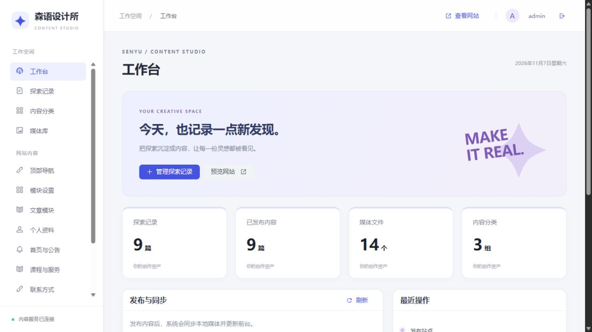
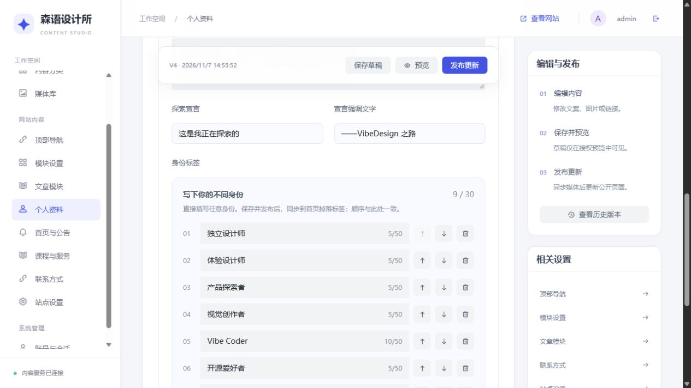
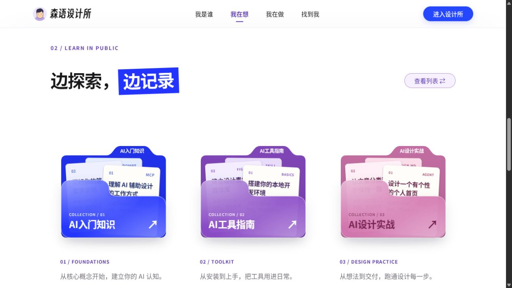
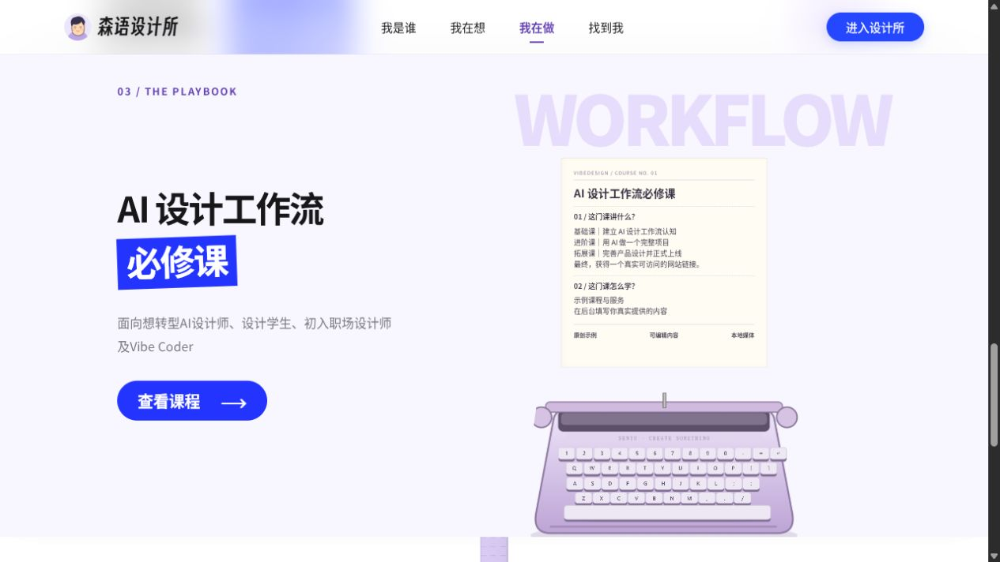

# 后台使用教程

## 登录与工作台

开发环境访问 `http://localhost:5173/admin/`；生产环境为自己域名下的 `/admin/`。账号来自首次初始化时的安全配置，仓库不提供通用密码。

工作台显示文章、已发布内容、分类、媒体数量，以及发布同步任务。Redis 连接与命中信息只用于缓存状态观察，MySQL 始终是权威数据源。

## 个人资料与身份标签

进入「个人资料」填写名字、角色、介绍、头像与主图。身份标签直接填写任意文字，支持新增、删除、上移、下移；最多 30 条，每条最多 50 字，不能空白或重复。

保存草稿不会影响访客看到的公开版。点击预览检查标签，再发布；前台掉落标签使用发布后的同一份数据。

## 顶部导航、按钮和模块

- 「顶部导航」维护菜单名称、链接、顺序、显示状态与打开方式。
- 右上角按钮可编辑名称和链接，默认「进入设计所」。
- 「模块设置」控制六个区域的可见性、标题与公告链接。
- 「文章模块」为每个分类选择最多三篇展示文章和顺序，卡片与文章列表、星球使用同一公开文章数据。
- 只保存站点资料草稿时，线上仍显示旧版本；需要发布才能生效。

## 写文章或添加外链

1. 在「探索记录」新建或打开文章，选分类并设置标题、slug、摘要、标记、排序和封面。
2. 站内文章使用富文本正文；外链文章填写 http(s) 地址。
3. 保存草稿，使用签名预览链接查看。
4. 发布后等待工作台显示「已同步」。

已发布文章如需修改 slug，先下线再修改。下线保留草稿与历史。版本恢复只把旧内容恢复到草稿，确认后需重新发布。编辑冲突提示意味着其他页面已修改内容，请刷新并合并自己的改动。

分类名称、颜色和顺序为即时发布，修改后会立即更新访客分类；文章正文仍使用自己的发布快照。

## 课程与服务

维护课程标题、介绍、学习方式、统计文案、配图及跳转链接。默认只是演示内容，没有支付或课程购买系统。更换打字机配图时，内置键帽位置按默认 1536×1024 模板定位；任意图片不保证键帽切片对齐，建议沿用默认模板或同步修改 `CoursePrinter.tsx` 的坐标。

## 媒体库与名片背面

后台上传支持 PNG、JPG、WebP、AVIF、GIF，最大 12 MB / 4000 万像素。媒体入库后可以设置替代文字，查看草稿和历史版本的引用。

- 私有原件在未发布时需要认证读取。
- 发布后只把公开内容引用的文件复制到 public 目录。
- 在用或被历史引用的图片禁止直接移除；后台删除为软删除，不是物理清库。
- 「联系方式 → 名片背面／微信二维码」选择自己的图片，保存草稿并发布。
- 背面图片以 contain 等比完整居中，保留安全边距；微信按钮翻面显示。
- 开源默认背面为占位图，部署者需自行上传自己的二维码。

## 预览、发布与缓存

预览链接有效期 15 分钟，持有链接的人可查看相应草稿与图片，不要公开传播。页面设置不被搜索引擎收录。

发布时 MySQL 公开快照和公共版本同事务更新，Redis 切换到新的版本 key。媒体同步为后台任务；「发布提交成功」不等于「已同步」。失败时检查文件权限和前台内部地址，再重试。

## 账号与备份

在「账号与会话」修改密码或撤销其他会话。改密后使用新密码登录；原始配置文件中的初始化密码不会跟随变化。

定期备份完整数据库 SQL 与整个媒体目录。只备份后台静态文件或 Redis 无法恢复站点。
