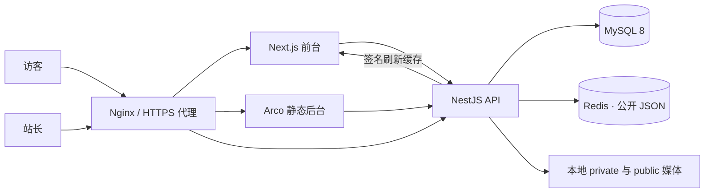

# 架构与接口

## 服务关系

生产环境为单 API 实例。发布任务存 MySQL，服务重启会将中断任务恢复到等待状态。每 4 秒处理队列，先同步公开媒体，再刷新 Next.js 的站点数据缓存，失败最多自动尝试 5 次，之后可以在工作台手动重试。首期没有多实例分布式队列锁，扩容 API 前需补上原子任务认领与共享存储。

## 数据模型

| 表 | 作用 |
|---|---|
| User | 单站长管理员账号、Argon2id 密码哈希 |
| Session | 哈希后的登录令牌、CSRF、12 小时有效期 |
| Category | 分类名称、颜色、顺序、文件夹说明 |
| Article | 草稿 JSON、公开 JSON、分类、slug、顺序、修订号 |
| Setting | 站点配置草稿、公开快照、修订号 |
| ContentVersion | 修改前的内容快照，接口显示最近 50 次 |
| Media | 本地文件 key、原名、尺寸、格式、替代文字、缩略图与软删除时间 |
| PublishJob | 持久化发布同步任务、状态、尝试次数、错误 |
| PublicContentRevision | 公共内容版本，与发布和下线同事务更新 |
| AuditLog | 公开发布和下线操作记录 |

文章的公开 JSON 包含发布时的分类 ID 和排序。草稿编辑不会改变公开快照。修订更新使用带条件的事务写入，同一修订号的并行修改只能成功一次。

分类是立即保存发布；没有独立分类草稿。被文章或已发布快照引用的分类无法删除。文章下线后保留草稿和历史，首期不提供文章物理删除界面。

## API

前缀 `/api/v1`，管理接口需要会话 Cookie，所有管理写操作还需要准确的 Origin 和 `x-csrf-token`。请求 JSON，上传接口为 multipart/form-data 的 `file` 字段。

| 区域 | 接口 |
|---|---|
| 健康 | `GET /health` |
| 认证 | `POST /auth/login`、`GET /auth/me`、`POST /auth/logout` |
| 账号 | `GET /auth/account`、`POST /auth/password`、`POST /auth/revoke-others` |
| 公开 | `GET /public/site`、`GET /public/articles/:slug` |
| 预览 | `POST /admin/preview`、`GET /preview?token=...` |
| 工作台 | `GET /admin/dashboard`、`POST /admin/jobs/:id/retry` |
| 站点 | `GET/PUT /admin/site`、`POST /admin/site/publish` |
| 版本 | `GET /admin/site/versions`、`POST /admin/site/restore/:id` |
| 分类 | `GET/POST /admin/categories`、`PUT/DELETE /admin/categories/:id` |
| 文章 | `GET/POST /admin/articles`、`PUT /admin/articles/:id` |
| 文章发布 | `POST /admin/articles/:id/publish`、`POST /admin/articles/:id/unpublish` |
| 文章版本 | `GET /admin/articles/:id/versions`、`POST /admin/articles/:id/restore/:version` |
| 媒体 | `GET/POST /admin/media`、`PATCH/DELETE /admin/media/:id` |
| 引用查询 | `GET /admin/media/:id/references` |
| 私有原图 | `GET /media/private/:key`，完整路径为 `/api/v1/media/private/:key` |
| 公开文件 | `GET /media/:key`，此路径没有 `/api/v1` 前缀 |

预览令牌是带过期时间的 HMAC 签名。预览可读取草稿，图片通过带令牌的私有接口访问；预览页面设置 noindex 和 no-referrer。预览令牌可以读取有效期内的私有媒体，因此不要公开分享预览链接。

## 本地媒体与发布一致性

`private/originals` 存原图，`private/variants` 存自动生成的 WebP 缩略图，`public` 仅存公开引用副本。前台和正文持久化 `/media/key`，后台编辑器将其渲染为认证私有地址。前台不热链参考站图片、字体或脚本。

内容发布成功后数据库立即记录公开快照；媒体和页面缓存随后异步同步。后台“已提交发布”表示提交成功，工作台“已同步”才表示任务完成。文件缺失或前台服务不可用时会显示失败／重试状态。

撤回图片通过移除没有其他公开引用的 public 副本完成，不会清除浏览者已经下载或自行保存的图片。公开文件采用 must-revalidate，网关不缓存媒体。历史版本仍引用的私有原图不会被媒体移除操作清理。

## 首期边界

单站长、中文站点、图片媒体、课程介绍与外链咨询。没有支付、会员、视频托管、飞书自动同步、多人审批或对象存储；这些不属于本次参考站复刻的首期范围。后台桌面操作优先，手机保留基础布局；前台包含手机与平板断点。

## Redis 缓存

只缓存公开首页及已发布文章 JSON，TTL 300 秒，key 含 MySQL 公共版本。发布、下线与分类变更递增版本；旧请求晚写只影响旧版本 key。Redis 故障回源 MySQL，恢复后读取新版本。后台、会话和草稿不进入公共缓存，Next.js 内容请求采用 no-store。
